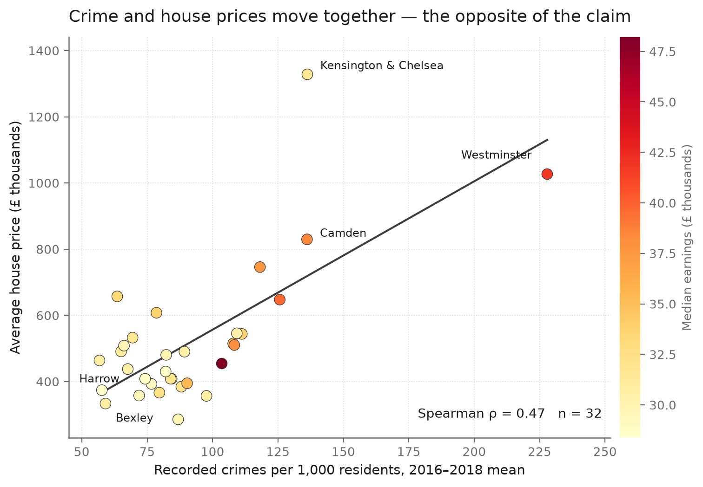
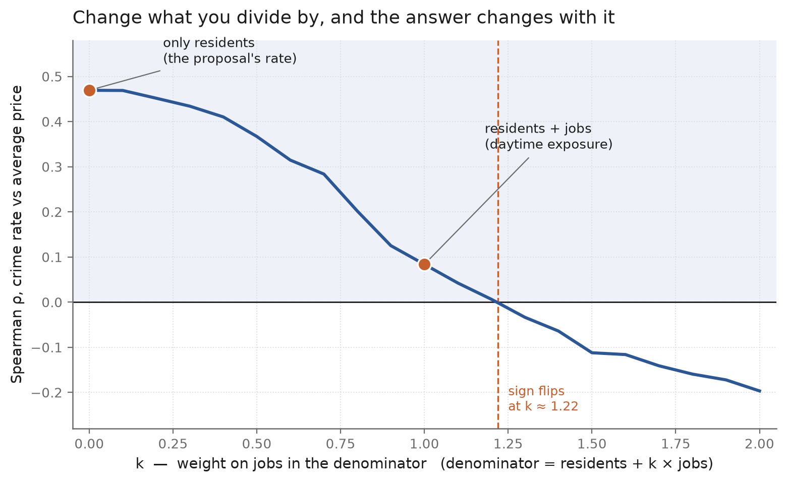
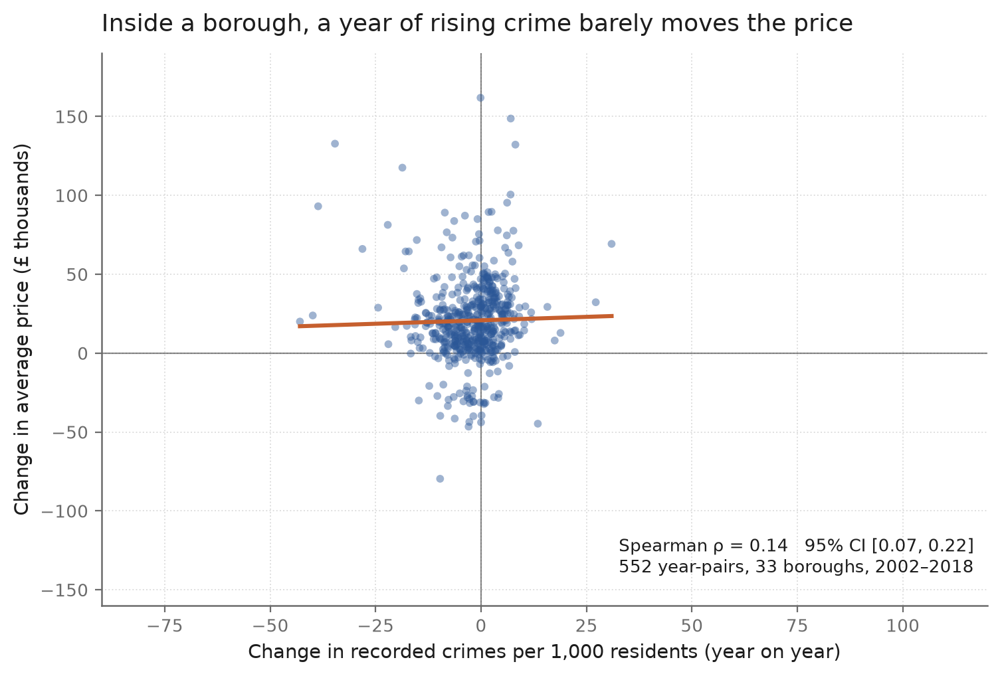

# Crime and House Prices in London Boroughs

**Team 05 · CISC7204 Data Science and Data Visualization · University of Macau**
MSc Programme · Semester 1, 2026/27

> Does a borough with more recorded crime have cheaper housing?
> Using 18 years of open London data, the answer turns out to depend almost entirely
> on **how the crime rate is defined** — and on **which side of the city** you look at.

**Repository maintained by [WANG Weicheng](CONTRIBUTIONS.md)** — team reporter and project analyst.
See [what I contributed](#what-i-contributed) and the full [contribution statement](CONTRIBUTIONS.md).



*Figure 1 — The common-sense claim predicts a downward slope. In the 2016–2018 borough
means the cloud slopes **up** (Spearman ρ = 0.470). The rest of the project is about
why that number cannot be read at face value.*

---

## Research question

**Is a higher recorded crime rate associated with lower house prices across London boroughs —
and is that association robust to how the rate is measured, where you look, and when?**

The project is deliberately built as a *stress test* of a single correlation rather than a
search for a headline. The starting point reproduces the team's pilot result (ρ = 0.47);
the contribution is the series of checks that show how fragile it is.

---

## Key findings

| Check | Result | Reading |
|---|---|---|
| Crime rate per resident vs price (n = 32) | **ρ = 0.470** (permutation *p* = 0.008) | Reproduces the pilot; direction is the *opposite* of common sense |
| Control for median earnings | **ρ = 0.243** | Halves — earnings sit on both sides |
| Crime rate per *(residents + jobs)* vs price | **ρ = 0.084**, 95% CI [−0.30, 0.44] | Essentially zero |
| Both adjustments at once | **ρ = 0.053** | Nothing left |
| Inner London (11 boroughs) | **ρ = 0.827** (*p* = 0.002) | Strongly positive |
| Outer London (21 boroughs) | **ρ = −0.294** (*p* = 0.20) | Negative but **not significant** |
| Within-borough year-to-year changes (552 pairs) | **ρ = 0.144**, cluster-bootstrap CI [0.07, 0.22] | Small but stable |
| Leave-one-borough-out | ρ stays in **0.417 – 0.546** | Not driven by a single borough |

**The core result is a curve, not a point.** Re-weighting the denominator from
`residents` to `residents + k × jobs` moves the correlation steadily from +0.47 to −0.20,
crossing zero at **k ≈ 1.22**:



*Figure 4 — ρ as a function of how much weight is placed on daytime workers in the
denominator. A sign that flips across a plausible range of definitions is a sign that
should not be quoted as a single number.*

Two further readings matter:

- **Boroughs with more jobs have both higher prices and higher recorded crime**
  (ρ = 0.655 and 0.508 respectively). This is confounding, not a causal channel —
  and the two "explanations" (earnings and job density) are themselves correlated at **0.70**.
- **Offence type matters enormously.** Burglary (ρ = 0.742) and theft (0.638) track prices
  closely; violence (0.262) and criminal damage (−0.007) do not. A single "crime" aggregate
  hides this.



*Figure 6 — Year-to-year changes inside each borough (552 pairs). The within-borough
association is far weaker than the cross-section, which is what a confounded
cross-section should look like.*

---

## Data

| File | What it is | Source | Licence / usage |
|---|---|---|---|
| `data/housing_in_london_monthly.csv` | Monthly average house price by London borough, 1995–2020 | Kaggle, *Housing in London* (compiled from London Datastore) | UK Open Government Licence v2 / v3 |
| `data/housing_in_london_yearly.csv` | Yearly population, jobs, median & mean salary, recycling, life satisfaction | same | same |
| `data/MPS_Borough_Level_Crime_Historical.csv` | Recorded crime counts by borough × offence type × month, Apr 2010 – Apr 2024 | London Datastore, *MPS Borough Level Crime (Historical)* | UK Open Government Licence v2 |
| `data/borough_summary_2016_2018.csv` | 32-borough 2016–2018 summary produced by the team (not used by the pipeline) | derived | — |

> Contains public sector information licensed under the Open Government Licence.
> Both upstream sources are open data published by the Greater London Authority and the
> Metropolitan Police Service. No personal or restricted data is included in this repository.
> The housing files are redistributed unmodified so that the analysis can be re-run offline.

**Coverage note.** Crime counts run to 2019, but `population_size` and `number_of_jobs`
are blank for 2019, so the crime-*rate* panel ends at **2018** (585 borough-years).
Before 2010 the panel has 33 areas (City of London included); from 2010 on, 32.

---

## Methods

- **Python** — `pandas` for the panel, `numpy` for the statistics, `matplotlib` for figures.
- **Measure** — Spearman rank correlation throughout, because the relationship is monotone
  but not linear and the boroughs vary by two orders of magnitude in price.
- **Inference** — permutation tests for the cross-section (2,000 shuffles), and a
  **cluster bootstrap** for the within-borough panel (resampling boroughs, not year-pairs),
  which is the correct unit of dependence.
- **Cross-section** — 2016–2018 borough means, n = 32.
- **Panel** — borough-year observations 2001–2018; first differences for the
  within-borough analysis (552 year-pairs across 33 boroughs).
- **Robustness** — denominator sweep (k = 0.0 … 2.0), earnings partialling, inner/outer
  stratification, leave-one-borough-out, offence-type decomposition, lead/lag check, and a
  cross-validation of the two independent crime totals (MPS vs. monthly file, ratio 0.986).

---

## Repository layout

```
cisc7204-team05-london-housing-crime/
├── README.md                  # this file
├── CONTRIBUTIONS.md           # who did what, and what I contributed
├── requirements.txt
├── analysis.ipynb             # the executable notebook (pre-run, 8 figures)
├── data/                      # open data, unmodified
│   ├── housing_in_london_monthly.csv
│   ├── housing_in_london_yearly.csv
│   ├── MPS_Borough_Level_Crime_Historical.csv
│   ├── borough_summary_2016_2018.csv
│   └── README.md              # per-file provenance and caveats
├── figures/                   # fig1–fig8 from src/make_figures.py
│                              # (running the notebook also writes figures/analysis/)
├── src/
│   ├── build_analysis.py      # rebuilds the panel and every statistic → out/
│   └── make_figures.py        # redraws all figures from out/
└── out/                       # generated: results.md, results.json, panels
```

Nothing is hard-coded to a local path: both scripts resolve their inputs relative to the
repository root, so a fresh clone runs as-is.

---

## How to run

```bash
# 1. get the code and install dependencies
git clone https://github.com/WANG-WEICHENG-mc644348/cisc7204-team05-london-housing-crime.git
cd cisc7204-team05-london-housing-crime
pip install -r requirements.txt

# 2a. read the analysis as a notebook (already executed, all outputs included)
jupyter notebook analysis.ipynb

# 2b. or re-run the whole pipeline from the raw CSVs
python src/build_analysis.py     # → out/results.md, out/results.json, panels
python src/make_figures.py       # → figures/fig1 … fig8
```

The scripts are deterministic given the CSVs in `data/`; re-running them reproduces
`out/results.md` byte-for-byte. **Tested on** Python 3.13 with pandas 3.0.3,
numpy 2.4.6 and matplotlib 3.11.0.

---

## Limitations

1. **Ecological fallacy.** These are borough aggregates. A correlation between borough-level
   crime rates and borough-level prices says nothing about individual households, and
   nothing about causal direction.
2. **Recorded crime ≠ crime.** Police recording practices changed over the period
   (notably after 2012–13), and reporting rates vary by offence type and by borough.
   The offence-type decomposition is a partial check, not a correction.
3. **Two plausible denominators, opposite answers.** Resident-based and
   resident-plus-worker-based rates are both defensible; they produce +0.47 and +0.08.
   The honest conclusion is a range, not a point — this is why the paper reports the
   whole k-curve instead of one number.
4. **The panel stops at 2018** because population and jobs are missing for 2019
   (0 of 33 boroughs), so the most recent years cannot enter the rate analysis.
5. **Small n.** 32 boroughs, 11 of them inner London. The outer-London estimate
   (ρ = −0.294) has *p* = 0.20 and should not be read as evidence of a negative relationship.

---

## What I contributed

This is a six-person team project. My official roles were **Team reporter** and
**Project analyst**; my lead product was the **within-borough change analysis and its figure**.

Concretely, in this repository I:

- designed and ran the **within-borough year-to-year analysis** (552 year-pairs, cluster
  bootstrap, City of London sensitivity) and produced `figures/fig6_within.png`;
- defined the **year-pair rule** that decides which consecutive observations enter the
  change sample;
- built the **reproducible analysis pipeline** in `src/` that recomputes every statistic
  and every figure from the two source CSVs, and regenerated `analysis.ipynb` from it;
- ran the **denominator sweep** and the robustness checks reported above;
- wrote and delivered the **project presentation** and edited the introductory video.

Full role table for all six members: **[CONTRIBUTIONS.md](CONTRIBUTIONS.md)**.

---

## Team

| Member | Role |
|---|---|
| **WANG Weicheng** | **Team reporter · Project analyst** (within-borough changes, change figure, pipeline, presentation) |
| FAN ZI QIAN | Team coordinator · Project tracker (aggregation, baseline correlations, Figure 1) |
| WONG SI IEONG | Team scribe · Team liaison (minutes, recordings, captions) |
| HE YING | Project analyst · Quality reviewer (earnings adjustment, rubric) |
| LI LU SHI | Project analyst (robustness rows, source log, submission) |
| LI SI WEI | Project developer (notebook pipeline, clean-kernel rerun) |

*Student IDs are omitted from this public repository; they appear in the submitted work plan.*

---

## Project status

**Ongoing.** The statistical core is complete and reproducible. Work still open:
extending the panel past 2018 once population estimates are published, adding a
spatial model (boroughs are not independent observations), and turning Figure 4 into an
interactive parameter explorer.

---

*Course: CISC7204 Data Science and Data Visualization, University of Macau, 2026/27.
Data © Greater London Authority / Metropolitan Police Service, used under the
Open Government Licence.*
